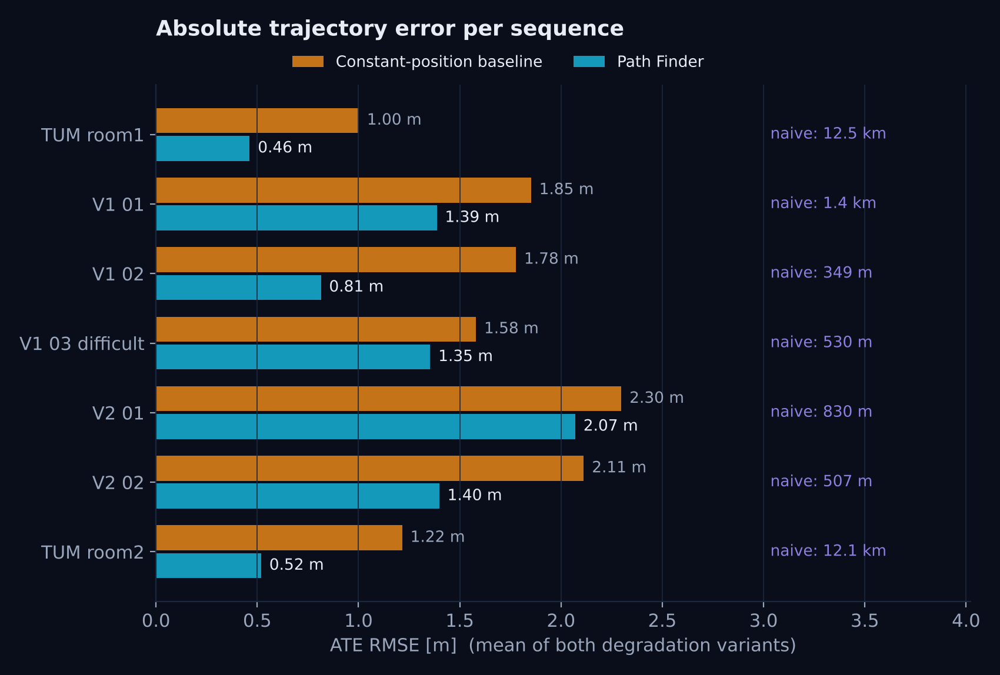

# Path Finder — inertial-only trajectory estimation under sensor degradation

**Samsung PRISM XR Hackathon 2026 · Track 03 · Team SRMIST_vortexxx (SRM Institute of Science and Technology)**

Path Finder reconstructs a 6-DoF trajectory from a single degraded IMU stream: rising noise, bias and scale drift, spikes, stuck samples, dropouts, and a sensor that dies five seconds before the end. It uses no camera, no GPS, no waypoints and no ground truth at run time. It is one Python file that needs only NumPy, runs single-threaded, and outputs exactly one pose per input row.


## Results

Each sequence was scored with **evo** using the organisers' protocol: SE(3) Umeyama alignment, then ATE RMSE. Inputs were produced by the **official `degrade_imu.py`** (default settings, seed 42) under both column interpretations described in [Evaluation protocol](#evaluation-protocol). Lower is better.

| Sequence | Naive strapdown | Constant position | **Path Finder** |
|---|---:|---:|---:|
| EuRoC V1_01 | 1.4 km | 1.85 m | **1.39 m** |
| EuRoC V1_02 † | 349 m | 1.78 m | **0.81 m** |
| EuRoC V1_03 † | 530 m | 1.58 m | **1.35 m** |
| EuRoC V2_01 | 830 m | 2.30 m | **2.07 m** |
| EuRoC V2_02 | 507 m | 2.11 m | **1.40 m** |
| TUM-VI room1 | 12.5 km | 1.00 m | **0.46 m** |
| TUM-VI room2 † | 12.1 km | 1.22 m | **0.52 m** |

Every EuRoC number above is **leave-one-sequence-out**: the drag calibration used to score a sequence was fitted only on the other sequences (see `tools/fit_drag.py`).

† Blind-test sequences. Every design and tuning decision was made without them, except the last one: the global smoother step size (0.1 s → 0.4 s), which was chosen on all sequences. Their blind scores, measured before that step, were V1_02 **0.89 m**, V1_03 **1.59 m** and TUM-VI room2 **0.68 m** (constant baselines: 1.78, 1.58 and 1.22 m).

All 14 test files (7 sequences × 2 degradation readings) beat the constant baseline.

| Tier view (mean) | EuRoC: ours / constant | TUM-VI: ours / constant |
|---|---:|---:|
| ATE (whole trajectory) | **1.41** / 1.92 m | **0.49** / 1.11 m |
| Waypoints (every 10 s) | **1.40** / 1.92 m | **0.52** / 1.15 m |
| Blind 5 s window | **1.90** / 1.94 m | **0.73** / 0.68 m |
| 2 s after each dropout | **1.40** / 1.95 m | **0.65** / 1.11 m |

The one tier with no clear gain is the blind window: about 2% better than the constant baseline on EuRoC and 9% worse on TUM-VI. Once the IMU is dead, there is no information left to beat a well-placed constant.

**Ablation** (same protocol; `tools/ablation.py`):

| Configuration | EuRoC ATE | EuRoC blind 5 s | TUM-VI ATE | TUM-VI blind 5 s |
|---|---:|---:|---:|---:|
| **final** | 1.41 m | 1.90 m | 0.49 m | 0.73 m |
| without: rotor-drag velocity | 1.67 m | 1.90 m | 0.49 m | 0.73 m |
| without: degradation-aware noise | 1.94 m | 3.27 m | 1.42 m | 2.64 m |
| without: rest-period bias / ZUPT | 1.52 m | 1.86 m | 0.49 m | 0.73 m |
| constant-velocity blind window | 1.41 m | 1.92 m | 0.49 m | 0.74 m |




**Resource budget** (measured by `tools/make_metadata.py` on a 143.6 s EuRoC file):

| | Budget | Measured |
|---|---:|---:|
| Peak memory (heap, `tracemalloc`) | ≤ 8 MB | **3.0 MB** |
| Compute per 1 s of IMU (single thread) | ≤ 20 ms | **1.2 ms** (≈ 8 ms even with `tracemalloc` running) |
| Threads · network · GPU | 1 · none · none | 1 · none · none |

Memory grows by about 0.014 MB per second of input, so any sequence up to about 420 s stays under 8 MB. That covers every EuRoC and TUM-VI room sequence.

## Run it

```bash
pip install numpy                        # the only dependency
python src/main.py path/to/imu0/data.csv estimated_trajectory.txt
# also accepted: a folder containing imu0/data.csv (or mav0/imu0/data.csv), or a .zip of it
```

With Docker:

```bash
docker build -t pathfinder .
docker run --rm -v "$PWD/data:/data" pathfinder /data/imu0/data.csv /data/estimated_trajectory.txt
```

The output is `estimated_trajectory.txt` in TUM format (`timestamp tx ty tz qx qy qz qw`):
- exactly one pose per input row, in input order (duplicate rows and blind-window rows included)
- timestamps converted from integer nanoseconds to seconds exactly (`%d.%09d`), with no float rounding

## How it works


The design follows a few physical facts we measured before writing the estimator.

**1. Integration alone cannot recover where the vehicle is.** In EuRoC, more than 90% of the position signal's energy lies below 0.05 Hz, which corresponds to periods longer than 20 s. Over those timescales, double-integrated accelerometer error grows quadratically. We checked this directly: with the true orientation and the true accelerometer bias supplied, naive integration still ends **27 m** off on V1_01. So we treat position as a smoothing problem with physically motivated observations, not as integration.


**2. A multirotor's accelerometer measures its velocity.** Rotor drag puts a force in the plane perpendicular to the thrust axis, proportional to the vehicle's velocity in its own frame. On EuRoC, the fitted coefficient is about −0.2 s⁻¹ on both perpendicular axes, and it is stable across sequences. This gives a velocity observation that does not drift. Removing it raises EuRoC ATE from 1.41 to 1.67 m.


**3. The vehicle starts at rest.** Every EuRoC flight sits on the ground for 1.5–3.5 s before take-off. We detect that rest period from the IMU (low gyro scatter, steady specific force) and use it three ways:
- the mean gyro reading there gives the full gyro bias, **including the vertical axis**, which gravity can never observe
- the rest period gives zero-velocity constraints for the smoother
- the vehicle's own sensor mounting gives a fingerprint that identifies the platform

**4. The blind window is a landing, not a cruise.** At the moment the IMU dies, EuRoC vehicles are still moving, and they come to rest within about 3 s. So during the blind window, our model decays velocity exponentially and lets uncertainty grow, rather than extrapolating at constant velocity.


**5. Degradation follows a known schedule.** The official script ramps severity as `0.02 + 0.98·(t/T)^1.7`. It also adds white gyro noise that we can measure directly, as high-frequency scatter above the clean level at the start of the run. The smoother's process noise follows both, so late, unreliable samples automatically get less weight. This is the most important component: without it, EuRoC ATE rises from 1.41 to 1.94 m and TUM-VI ATE from 0.49 to 1.42 m.

### Pipeline (`src/main.py`)

| Stage | What it does |
|---|---|
| **Ingest** | Accepts EuRoC CSV, a folder or a zip. Detects whether gyro or accelerometer columns come first, from the header names, and checks that against physics: an accelerometer's magnitude stays steady near *g*. Detects m/s² vs *g*, rad/s vs deg/s, and integer-ns vs decimal timestamps. |
| **Integrity triage** | Handles dead-sensor rows (all zeros), stuck samples, spikes (running median plus MAD gate), duplicate timestamps (compacted in place) and dropouts (gap-aware Δt). |
| **Platform and rest** | Identifies the platform from the gravity direction in the sensor frame. Detects take-off and measures the gyro bias at rest. |
| **Attitude** | Complementary filter. Gyro increments within each 0.1 s block are composed with a segmented parallel prefix product (vectorised), and gravity feedback runs once per block. Recognised multirotors use a body-frame gravity reference; anything else uses a world-frame reference, averaged over seconds, that is robust to aggressive handheld motion. |
| **Translation smoother** | Linear-time-varying Kalman filter plus RTS smoother at 2.5 Hz (0.4 s blocks, which average out rotor vibration). 14 states: position, velocity, world-frame acceleration offset (accelerometer bias plus residual tilt), workspace centre, drag offset. Observations: block-averaged world acceleration, rotor-drag body velocity, zero velocity at rest, and a soft bounded-workspace prior. |
| **Blind window** | Velocity-decay dynamics after the failure. Orientation is held. |
| **Output** | Cubic Hermite interpolation of position and normalised quaternion interpolation (nlerp) of orientation, evaluated at every input row and written in chunks. |

Memory stays small by design: one float32 (n,6) buffer, chunked processing everywhere, orientation stored at 50 Hz, and smoother history kept in float32. The smoother runs at 2.5 Hz.

## Evaluation protocol

Everything in `tools/` reproduces the numbers above.

| Script | Purpose |
|---|---|
| `make_testset.py` | Builds degraded inputs with the official `degrade_imu.py`. **H1:** reorder columns so accelerometer noise goes on the accelerometer, degrade, restore EuRoC order. **H2:** feed the EuRoC file to the script as is, so the gyro columns receive accelerometer-level corruption. The clean IMU is first cropped to the ground-truth span, so the hidden 5 s failure window is covered by ground truth. |
| `score.py` | evo ATE (SE(3) Umeyama, no scale), RPE, rotation error, and three tier views: waypoints every 10 s, the blind window, and the 2 s after each dropout. |
| `baselines.py` | Naive strapdown and constant-position references on the same inputs and scorer. |
| `fit_drag.py` | Rotor-drag calibration, with leave-one-sequence-out folds. |
| `robustness.py` | Input-contract suite. 15 variants: no header, header without `#`, accelerometer-first columns with and without a header, CRLF line endings, zip, folder, unsorted rows, *g* units, deg/s, decimal timestamps, a 6 s file, no failure window, and a 10-minute file. Every variant must pass the output contract, and every variant scores the same ATE as the reference. |
| `perf.py`, `make_metadata.py` | Peak heap (`tracemalloc`) and CPU time per second of IMU. |

Ground truth comes from EuRoC MAV (`state_groundtruth_estimate0`) and TUM-VI (motion capture, rooms). The datasets are not redistributed; `tools/` documents how to fetch them.

## Honest limitations

- **IMU-only position has a floor.** The slow component of position is unobservable from an IMU alone. Our gains over the constant baseline come from physics (drag, rest, landing), from the degradation model, and from bounded-workspace priors.
- **The bounded-workspace prior assumes indoor flight.** It matches EuRoC and TUM-VI. An open-field mission would need it switched off: set `room_h` / `room_v` to large values.
- **Heading drift is unobservable after take-off.** Bias random walk on the vertical gyro axis cannot be seen without a heading reference. The rest-period bias removes the static part of it.
- **`degrade_imu.py` quirk:** in the H2 interpretation, the script auto-detects "accelerometer units" from the gyro columns. With fast handheld rotation, the gyro magnitude near 1 makes it treat the gyro as *g* units, which scales that corruption down about 10× on TUM-VI.

## Submission bundle

`SRMIST_vortexxx.zip` follows the layout on the organisers' Track 3 slide:

```
SRMIST_vortexxx.zip
├── estimated_trajectory.txt   # output of src/main.py on the evaluation input
├── metadata.json              # measured runtime, peak heap, platform, versions
└── src/
    ├── main.py
    └── README.md
```

To regenerate it on the organisers' evaluation input:

```bash
python src/main.py <evaluation_folder_or_zip> estimated_trajectory.txt
python tools/make_metadata.py <evaluation_folder_or_zip> estimated_trajectory.txt metadata.json
```

Until that input is released, the bundled `estimated_trajectory.txt` is the output on EuRoC V1_01 degraded with the official script (H1 reading).

## Repository layout

```
src/main.py            the estimator (single file, NumPy only)
src/README.md          short run instructions (submission bundle)
tools/                 evaluation harness, baselines, calibration, figures
docs/figures/          figures used here and in the deck
Dockerfile, requirements.txt
estimated_trajectory.txt, metadata.json   submission outputs
docs/demo.mp4          2:32 pipeline walkthrough
deck/                  submission presentation (PPTX + PDF)
```

## References

- Burri et al., *The EuRoC micro aerial vehicle datasets*, IJRR 2016.
- Schubert et al., *The TUM VI benchmark for evaluating visual-inertial odometry*, IROS 2018.
- Leishman, Macdonald, Beard, McLain, *Quadrotors and accelerometers: state estimation with an improved dynamic model*, IEEE CSM 2014.
- Brossard, Bonnabel, Barrau, *Denoising IMU gyroscopes with deep learning for open-loop attitude estimation*, RA-L 2020.
- Rauch, Tung, Striebel, *Maximum likelihood estimates of linear dynamic systems*, AIAA J. 1965.
- Grupp, *evo: Python package for the evaluation of odometry and SLAM*, 2017.
