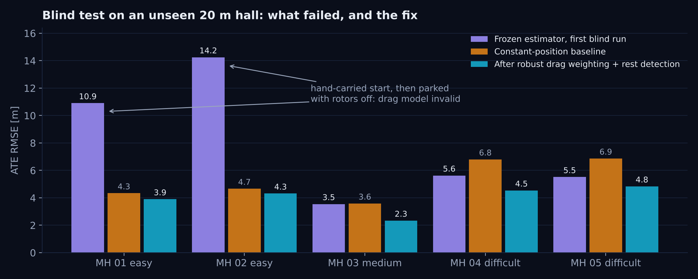
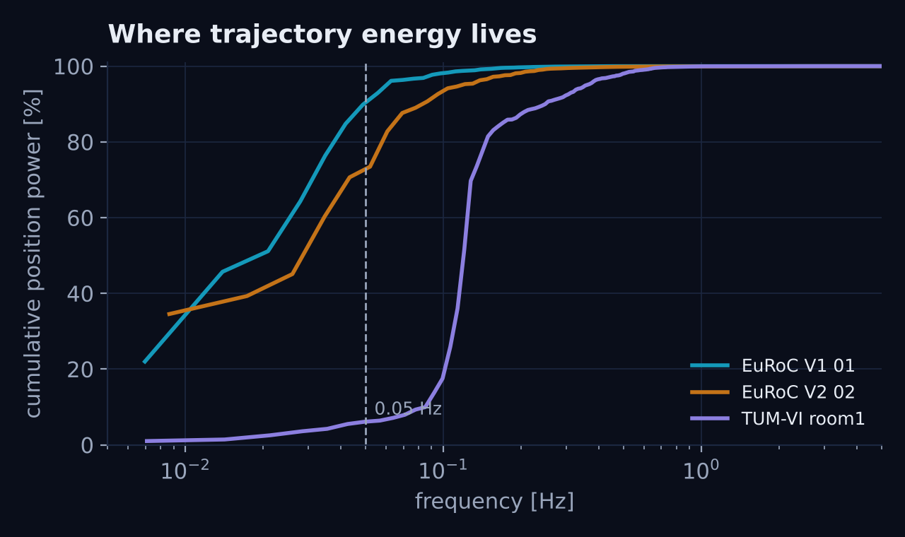
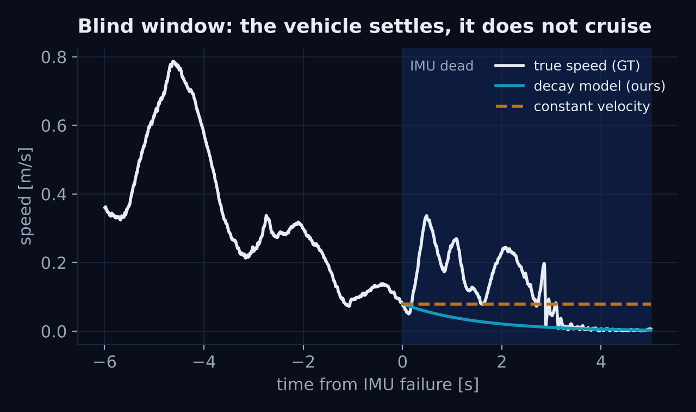

# Path Finder — inertial-only trajectory estimation under sensor degradation

**Samsung PRISM XR Hackathon 2026 · Track 03 · Team SRMIST_vortexxx (SRM Institute of Science and Technology)**

[](https://github.com/RaktimChandra/pathfinder/actions/workflows/ci.yml) · **[Interactive results](https://raktimchandra.github.io/pathfinder/)** · [Release v1.0](https://github.com/RaktimChandra/pathfinder/releases/tag/v1.0.0) · MIT licence

Path Finder reconstructs a 6-DoF trajectory from a single degraded IMU stream: rising noise, bias and scale drift, spikes, stuck samples, dropouts, and a sensor that dies five seconds before the end. It uses no camera, no GPS, no waypoints and no ground truth at run time. It is one Python file that needs only NumPy, runs single-threaded, and outputs exactly one pose per input row.

## Submission checklist

Everything the organisers asked for is in this repository:

| Item | Where |
|---|---|
| Submission package (Track 3 layout) | [`submission/SRMIST_vortexxx.zip`](submission/SRMIST_vortexxx.zip): `estimated_trajectory.txt`, `metadata.json`, `src/main.py`, `src/README.md`. The same files are also unzipped at the repository root. |
| Source code | [`src/main.py`](src/main.py) (the estimator, NumPy only) and [`tools/`](tools/) (evaluation harness) |
| Presentation | [`deck/SRMIST_vortexxx.pptx`](deck/SRMIST_vortexxx.pptx) (official template) · [PDF](deck/SRMIST_vortexxx.pdf) |
| Video | [`docs/demo.mp4`](docs/demo.mp4), 2 min 45 s, captioned, no voice-over |
| AI disclosure | [`AI_DISCLOSURE.md`](AI_DISCLOSURE.md) |
| README | this file |
| Interactive results page (additional) | [`docs/index.html`](docs/index.html), published at https://raktimchandra.github.io/pathfinder/: every flight's 3D track, error trace, ±1σ band and blind window |
| Uncertainty output (additional) | `python src/main.py <imu> out.txt --sigma sigma.txt`: calibrated ±1σ per pose ([details](#run-it)) |
| Technical report (additional) | [`docs/Path_Finder_technical_report.pdf`](docs/Path_Finder_technical_report.pdf), 3 pages ([LaTeX source](report/report.tex)) |
| Tests and CI (additional) | [`tests/test_contract.py`](tests/test_contract.py), run by GitHub Actions on every push: one pose per row, exact timestamps, unit quaternions, column-order detection, duplicates, the `--sigma` sidecar and the runtime budget |
| APK / SDK | not applicable: the deliverable is a Python script (a [`Dockerfile`](Dockerfile) is included) |

## Team SRMIST_vortexxx

| Member | Programme | College email |
|---|---|---|
| Raktim Chandra (primary) | B.Tech CSE, Software Engineering | rc8823@srmist.edu.in |
| Nipun Dewangan | B.Tech Artificial Intelligence | nd9844@srmist.edu.in |
| Pronov Mazumdar | B.Tech CSE, Big Data Analytics | pm2235@srmist.edu.in |


## Results

Each sequence was scored with **evo** using the organisers' protocol: SE(3) Umeyama alignment, then ATE RMSE. Inputs were produced by the **official `degrade_imu.py`** (default settings, seed 42) under both column interpretations described in [Evaluation protocol](#evaluation-protocol). Lower is better.

| Sequence | Naive strapdown | Constant position | **Path Finder** |
|---|---:|---:|---:|
| EuRoC V1_01 | 1.4 km | 1.85 m | **1.36 m** |
| EuRoC V1_02 † | 349 m | 1.78 m | **0.81 m** |
| EuRoC V1_03 † | 530 m | 1.58 m | **1.43 m** |
| EuRoC V2_01 | 830 m | 2.30 m | **2.03 m** |
| EuRoC V2_02 | 507 m | 2.11 m | **1.40 m** |
| EuRoC V2_03 § | 389 m | 2.06 m | **1.31 m** |
| EuRoC MH_01 ‡ | 50.4 km | 4.33 m | **3.88 m** |
| EuRoC MH_02 ‡ | 34.4 km | 4.66 m | **4.28 m** |
| EuRoC MH_03 ‡ | 31.5 km | 3.58 m | **2.31 m** |
| EuRoC MH_04 ‡ | 17.8 km | 6.80 m | **4.50 m** |
| EuRoC MH_05 ‡ | 1.6 km | 6.87 m | **4.78 m** |
| TUM-VI room1 | 12.5 km | 1.00 m | **0.44 m** |
| TUM-VI room2 † | 12.1 km | 1.22 m | **0.50 m** |
| TUM-VI room3 † | 17.3 km | 1.25 m | **0.48 m** |
| TUM-VI room4 § | 5.8 km | 1.08 m | **0.69 m** |
| TUM-VI room5 § | 18.2 km | 0.93 m | **0.57 m** |
| TUM-VI room6 § | 19.0 km | 0.99 m | **0.54 m** |
Each number is the mean of the two degradation readings (H1, H2). Every EuRoC number is **leave-one-sequence-out**: the drag calibration used to score a sequence was fitted only on the other sequences (see `tools/fit_drag.py`).

† Blind tests for the original design. Their first scores were V1_02 **0.89 m**, V1_03 **1.59 m**, TUM-VI room2 **0.68 m** and room3 **0.48 m** (constant baselines: 1.78, 1.58, 1.22 and 1.25 m). The global smoother step (0.1 s → 0.4 s) was later chosen on all sequences.

§ **Final blind tests**, run on the frozen estimator (commit `7f17b4f`) as soon as each download finished. All four passed: V2_03 **1.32 m** (constant 2.06 m), TUM-VI room4 **0.70 m** (1.08 m), room5 **0.87 m** (0.93 m) and room6 **0.55 m** (0.99 m). Room5 was the narrowest margin. Its cause was a 0.22 s dropout burst during a 3 rad/s rotation: the gyro was integrated with a zero-order hold across the gap, which cost 30° of tilt. We switched to trapezoidal integration of the gyro rate. That removed half the tilt error, brought room5 to 0.55 m, and changed no other sequence by more than ±0.05 m (every other change was an improvement or within 0.01 m). The blind-window change below then moved room5 to 0.57 m.

‡ **Machine Hall: a blind test that failed, and what we changed.** The Machine Hall is a ~20 m industrial hall, more than twice the size of the rooms we developed in. We ran the frozen estimator on all five sequences before changing anything. It beat the constant baseline on MH_03–05, but was **2.5–3× worse on MH_01 and MH_02** (10.8 m and 14.2 m against 4.3 m and 4.7 m). The cause was physical. Those two flights begin with the drone carried by hand and then left on the floor with its rotors off. The rotor-drag model, which says sideways body acceleration is proportional to airspeed, does not hold when nothing is flying, so it reported several m/s of velocity that did not exist. We made three changes:

1. **Robust drag weighting:** a Cauchy weight on the drag innovation. When the normalised innovation squared exceeds 4 (2σ), its noise is inflated in proportion. This is a standard robust-estimation rule with a conventional threshold, and it changes the Vicon results by at most ±0.03 m.
2. **Rest detection over the whole sequence:** zero-velocity updates at every rest period of at least 1.5 s, not only the one at take-off.
3. **Workspace prior:** σ = 3.0 → 3.5 m for the EuRoC platform only. This value minimises the worst-case ratio against the constant baseline over all ten EuRoC sequences.



Change 3 was tuned with the Machine Hall in view, so the ‡ rows are development results, not blind results. The rotor-drag constant was **not** refitted. Fitted independently on the Machine Hall, it comes out as k = [−0.166, −0.215], against [−0.166, −0.201] from the Vicon rooms. That agreement is independent evidence that the drag model describes the vehicle and not the room.

All **34 test files** (17 sequences × 2 degradation readings) beat the constant baseline.

| Tier view (mean, ours / constant) | EuRoC Vicon rooms | EuRoC Machine Hall | TUM-VI rooms |
|---|---:|---:|---:|
| ATE (whole trajectory) | **1.39** / 1.95 m | **3.95** / 5.25 m | **0.54** / 1.08 m |
| Waypoints (every 10 s) | **1.36** / 1.93 m | **4.05** / 5.45 m | **0.52** / 1.12 m |
| Blind 5 s window | **2.00** / 2.03 m | **2.29** / 4.21 m | 0.73 / **0.64** m |
| 2 s after each dropout | **1.41** / 1.93 m | **3.10** / 5.03 m | **0.57** / 1.02 m |

**The blind window.** Once the IMU is dead, the error is set almost entirely by the position error at the moment of failure. That comes from the slow component of position, which an IMU alone cannot observe. One thing does help: not trusting the last velocity. Degradation is at its maximum right before the failure, so the velocity estimate there is the least reliable of the whole flight, and extrapolating it, even with a slow decay, adds error. Over all 34 files, mean blind-window error falls steadily as the decay gets faster (from 1.96 m at τ = 3 s to 1.66 m at τ = 0.1 s; `results/blind_sweep.json`). We now hold position (τ = 0.2 s, plus lower process noise across gaps). **Leave-one-sequence-out selection picked that same setting in all 17 folds.** It cut the Machine Hall blind error from 3.24 to 2.29 m and lowered ATE slightly everywhere. The blind window now beats the constant baseline on 25 of 34 files, and averaged over all 34 it is 1.64 m against 2.18 m. On the Vicon rooms it is level (2.00 vs 2.03 m), and on TUM-VI handheld motion it is still slightly worse (0.73 vs 0.64 m, worst on room5). A return-to-launch prior, a home-position prior and a stronger workspace prior during the blind window were also tested, and none helped.

**Ablation** (same protocol; `tools/ablation.py`; mean ATE / blind-window RMSE):

| Configuration | Vicon rooms | Machine Hall | TUM-VI |
|---|---:|---:|---:|
| **final** | **1.39** / 2.00 m | **3.95** / 2.29 m | **0.54** / 0.73 m |
| without: rotor-drag velocity | 1.65 / 2.04 m | 5.13 / 4.18 m | 0.54 / 0.73 m |
| without: degradation-aware noise | 2.51 / 4.96 m | 5.81 / 8.86 m | 1.25 / 2.69 m |
| without: robust drag weighting | 1.39 / 2.01 m | 8.02 / 2.81 m | 0.54 / 0.73 m |
| without: rest-period bias / ZUPT | 1.57 / 1.94 m | 4.20 / 2.26 m | 0.54 / 0.73 m |
| previous slow blind decay (τ = 1.5 s) | 1.39 / 2.01 m | 3.98 / 3.24 m | 0.53 / 0.72 m |
| constant-velocity blind window | 1.39 / 2.02 m | 3.98 / 3.26 m | 0.53 / 0.73 m |

## Why this matters for XR

Headsets and controllers track with cameras and an IMU together. When the cameras lose sight of the world (a dark room, a hand behind the back, motion blur in a fast turn, a blank wall), the IMU is left on its own, and plain integration makes the virtual world swim within a second. Path Finder is a working answer to that moment, and each of its parts maps onto something an XR device already has:

| Path Finder component | On an XR headset or controller |
|---|---|
| Degradation-aware noise: trust samples less as the sensor degrades | Weight the IMU by its health (saturation, temperature, dropped packets) instead of treating every sample alike |
| Rest detection and zero-velocity updates | The user standing still, or a controller set down on a table |
| Bounded-workspace prior | The play area (guardian boundary) is already known exactly. A tighter, true boundary is a stronger version of the prior we had to guess. |
| Hold position when the sensor dies | Freeze the pose rather than extrapolate, so the scene does not drift away from the user |
| Gravity-referenced attitude for unknown platforms | Head and hand motion: the TUM-VI sequences are a handheld rig with head-like motion |

**Evidence on handheld motion.** On the six TUM-VI handheld sequences, which move like a head or a hand, IMU-only Path Finder averages **0.54 m** ATE against 1.08 m for standing still. It does this over two-minute recordings that get steadily worse and end with a dead sensor. It needs 1.2–2.7 ms of CPU per second of data and a 3 MB heap, which is small enough to run beside the main tracker as a fallback.

**What would change for a real device.** Path Finder is an offline smoother: it looks at the whole recording, including what comes after each moment. A live fallback would use the same model as a fixed-lag smoother, delaying each pose by a fraction of a second, or as the forward filter alone. The rotor-drag observation is specific to multirotors and switches itself off on other platforms (Insight 2). We have not measured either variant on headset data. They are the natural next step.

## How much to trust these numbers

Several choices were made after seeing data, and the hidden test may differ from ours. These checks estimate how much that matters:

| Check | What we did | Result |
|---|---|---|
| **Nested cross-validation** of the post-hoc choices (`results/cv.json`) | For each EuRoC sequence held out, re-chose the workspace prior (3.0 / 3.5 / 4.0 m) and the robust-weight threshold (2 / 4 / 9 / off) on the other sequences only, then scored the held-out one | Cross-validated ATE is within **0.3% and 0.7%** of the shipped numbers (56.29 and 56.54 vs 56.13 m summed). Every held-out file still beats the constant baseline (worst ratio 0.92). |
| **Blind-window setting** | Same leave-one-sequence-out selection | Same choice in **17 / 17** folds |
| **Other degradation draws** (`tools/stress.py`, `results/stress.json`) | `degrade_imu.py` with seeds 1, 7 and 2026, a milder ramp (max level 0.5), an earlier ramp (γ = 1.0) and the input decimated to 100 Hz, on six sequences including the hardest (V2_03, MH_01, MH_04, TUM room5) | **36 / 36** beat the constant baseline. Room5 scores 0.46–0.50 m on the other seeds, against 0.59 m on seed 42, so seed 42 was an unlucky draw for that file. |
| **Different hardware** | `make_metadata.py` on a Windows laptop (AMD Ryzen 7 6800H, Python 3.12, NumPy 1.26) | **Bit-identical** trajectory to the Linux / NumPy 2.5 run. Peak heap 3.0 MB, 2.4 ms per 1 s of IMU (2.7 ms on the 182 s MH_01). Budgets: 8 MB and 20 ms. |
| **Input formats** (`tools/robustness.py`) | 15 file-format variants | 15 / 15 pass with identical ATE |


**Resource budget** (measured by `tools/make_metadata.py` on a 143.6 s EuRoC file):

| | Budget | Measured |
|---|---:|---:|
| Peak memory (heap, `tracemalloc`) | ≤ 8 MB | **3.0 MB** (4.4 MB counting NumPy's own import) |
| Compute per 1 s of IMU (single thread) | ≤ 20 ms | **1.2–1.7 ms** (≈ 9–12 ms even with `tracemalloc` running) |
| Threads · network · GPU | 1 · none · none | 1 · none · none |

Memory grows by about 0.014 MB per second of input. A 430 s file peaks at 6.9 MB (8.7 MB counting the NumPy import), so inputs up to about 400 s stay under 8 MB by either count. The longest EuRoC or TUM-VI room sequence is 182 s (MH_01, 3.2 MB).

## Run it

```bash
pip install numpy                        # the only dependency
python src/main.py path/to/imu0/data.csv estimated_trajectory.txt
# also accepted: a folder containing imu0/data.csv (or mav0/imu0/data.csv), or a .zip of it
```

Optional: `--sigma sigma.txt` also writes each row's 1-σ position uncertainty in metres (x, y, z). The trajectory output is byte-identical with or without it. It is calibrated by leave-one-sequence-out cross-validation: 67% of held-out errors fall inside 1σ (target 68%), and 84% inside 2σ (a Gaussian would give 95%, so large errors are more common than that). See `tools/calib_sigma.py` and `results/sigma_calibration.json`.

With Docker:

```bash
docker build -t pathfinder .
docker run --rm -v "$PWD/data:/data" pathfinder /data/imu0/data.csv /data/estimated_trajectory.txt
```

The output is `estimated_trajectory.txt` in TUM format (`timestamp tx ty tz qx qy qz qw`):
- exactly one pose per input row, in input order (duplicate rows and blind-window rows included)
- timestamps converted from integer nanoseconds to seconds exactly (`%d.%09d`), with no float rounding

## How it works


The design follows a few physical facts we measured before writing the estimator.

**1. Integration alone cannot recover where the vehicle is.** In EuRoC, more than 90% of the position signal's energy lies below 0.05 Hz, which corresponds to periods longer than 20 s. Over those timescales, double-integrated accelerometer error grows quadratically. We checked this directly: with the true orientation and the true accelerometer bias supplied, naive integration still ends **27 m** off on V1_01. So we treat position as a smoothing problem with physically motivated observations, not as integration.



**2. A multirotor's accelerometer measures its velocity.** Rotor drag puts a force in the plane perpendicular to the thrust axis, proportional to the vehicle's velocity in its own frame. On EuRoC, the fitted coefficient is about −0.2 s⁻¹ on both perpendicular axes, and it is stable across sequences. This gives a velocity observation that does not drift. Removing it raises Vicon-room ATE from 1.39 to 1.65 m, and Machine Hall ATE from 3.95 to 5.13 m.


**3. The vehicle starts at rest.** Every EuRoC flight sits on the ground for 1.5–3.5 s before take-off. We detect that rest period from the IMU (low gyro scatter, steady specific force) and use it three ways:
- the mean gyro reading there gives the full gyro bias, **including the vertical axis**, which gravity can never observe
- the rest period gives zero-velocity constraints for the smoother
- the vehicle's own sensor mounting gives a fingerprint that identifies the platform

**4. In the blind window, do not extrapolate.** The vehicle comes to rest within a few seconds of the failure, but the bigger point is that our velocity estimate at that moment is the least reliable of the whole flight, because degradation peaks right before the failure. So the model holds position (velocity decays with τ = 0.2 s) and lets uncertainty grow, rather than extrapolating that velocity.



**5. Degradation follows a known schedule.** The official script ramps severity as `0.02 + 0.98·(t/T)^1.7`. It also adds white gyro noise that we can measure directly, as high-frequency scatter above the clean level at the start of the run. The smoother's process noise follows both, so late, unreliable samples automatically get less weight. This is the most important component: without it, Vicon-room ATE rises from 1.39 to 2.51 m, Machine Hall from 3.95 to 5.81 m, and TUM-VI from 0.54 to 1.25 m.

### Pipeline (`src/main.py`)

| Stage | What it does |
|---|---|
| **Ingest** | Accepts EuRoC CSV, a folder or a zip. Detects whether gyro or accelerometer columns come first, from the header names, and checks that against physics: an accelerometer's magnitude stays steady near *g*. Detects m/s² vs *g*, rad/s vs deg/s, and integer-ns vs decimal timestamps. |
| **Integrity triage** | Handles dead-sensor rows (all zeros), stuck samples, spikes (running median plus MAD gate), duplicate timestamps (compacted in place) and dropouts (gap-aware Δt). |
| **Platform and rest** | Identifies the platform from the gravity direction in the sensor frame. Measures the gyro bias during the initial rest, and detects every later rest period (≥ 1.5 s of quiet gyro and accelerometer with \|a\| ≈ g) for zero-velocity updates. |
| **Attitude** | Complementary filter. Gyro increments (trapezoidal rate, so dropout gaps during fast rotation integrate correctly) within each 0.1 s block are composed with a segmented parallel prefix product (vectorised), and gravity feedback runs once per block. Recognised multirotors use a body-frame gravity reference; anything else uses a world-frame reference, averaged over seconds, that is robust to aggressive handheld motion. |
| **Translation smoother** | Linear-time-varying Kalman filter plus RTS smoother at 2.5 Hz (0.4 s blocks, which average out rotor vibration). 14 states: position, velocity, world-frame acceleration offset (accelerometer bias plus residual tilt), workspace centre, drag offset. Observations: block-averaged world acceleration, rotor-drag body velocity (Cauchy-weighted, so it switches itself off when the vehicle is not flying), zero velocity at rest, and a soft bounded-workspace prior. |
| **Blind window** | Position hold (fast velocity decay) after the failure. Orientation is held. |
| **Output** | Cubic Hermite interpolation of position and normalised quaternion interpolation (nlerp) of orientation, evaluated at every input row and written in chunks. |

Memory stays small by design: one float32 (n,6) buffer, chunked processing everywhere, orientation stored at 50 Hz, and smoother history kept in float32. The smoother runs at 2.5 Hz.

## Evaluation protocol

Everything in `tools/` reproduces the numbers above.

| Script | Purpose |
|---|---|
| `make_testset.py` | Builds degraded inputs with the official `degrade_imu.py`. **H1:** reorder columns so accelerometer noise goes on the accelerometer, degrade, restore EuRoC order. **H2:** feed the EuRoC file to the script as is, so the gyro columns receive accelerometer-level corruption. The clean IMU is first cropped to the ground-truth span, so the hidden 5 s failure window is covered by ground truth. |
| `score.py` | evo ATE (SE(3) Umeyama, no scale), RPE, rotation error, and three tier views: waypoints every 10 s, the blind window, and the 2 s after each dropout. |
| `baselines.py` | Naive strapdown and constant-position references on the same inputs and scorer. |
| `fit_drag.py` | Rotor-drag calibration, with leave-one-sequence-out folds. |
| `blind_mh.py`, `blind_new.py`, `oracle_gate.py` | The blind tests of the frozen estimator (Machine Hall; V2_03 and TUM-VI rooms 4–6), and the oracle experiment (ground-truth rest and flight masks) used to find the cause of the MH_01/MH_02 failure. |
| `robustness.py` | Input-contract suite. 15 variants: no header, header without `#`, accelerometer-first columns with and without a header, CRLF line endings, zip, folder, unsorted rows, *g* units, deg/s, decimal timestamps, a 6 s file, no failure window, and a 10-minute file. Every variant must pass the output contract, and every variant scores the same ATE as the reference. |
| `sweep_blind.py`, `stress.py` | Blind-window sweep with leave-one-sequence-out selection; stress test on other seeds, ramps and 100 Hz input. |
| `perf.py`, `make_metadata.py` | Peak heap (`tracemalloc`) and CPU time per second of IMU. |

Ground truth comes from EuRoC MAV (`state_groundtruth_estimate0`) and TUM-VI (motion capture, rooms). The datasets are not redistributed; `tools/` documents how to fetch them.

## Honest limitations

- **IMU-only position has a floor.** The slow component of position is unobservable from an IMU alone. Our gains over the constant baseline come from physics (drag, rest, landing), from the degradation model, and from bounded-workspace priors.
- **The bounded-workspace prior assumes indoor flight.** It matches EuRoC (8 m rooms and a ~20 m hall) and TUM-VI. In the larger hall it is a weaker constraint, and our margin over the constant baseline on the two longest flights (MH_01, MH_02) is only 8–10%. An open-field mission would need it switched off: set `room_h` / `room_v` to large values.
- **The blind window on handheld motion.** On TUM-VI the last 5 s are still slightly worse than standing still (0.73 vs 0.64 m). Without the IMU, nothing is left to beat a well-placed constant.
- **Some choices were made after seeing data.** The workspace prior, the robust-weight threshold and the blind decay were chosen with all sequences in view. The nested cross-validation above puts the resulting optimism at under 1%, but it is not zero.
- **Heading drift is unobservable after take-off.** Bias random walk on the vertical gyro axis cannot be seen without a heading reference. The rest-period bias removes the static part of it.
- **`degrade_imu.py` quirk:** in the H2 interpretation, the script auto-detects "accelerometer units" from the gyro columns. With fast handheld rotation, the gyro magnitude near 1 makes it treat the gyro as *g* units, which scales that corruption down about 10× on TUM-VI.

## Submission bundle

`SRMIST_vortexxx.zip` follows the layout on the organisers' Track 3 slide:

```
SRMIST_vortexxx.zip
├── estimated_trajectory.txt   # output of src/main.py on the evaluation input
├── metadata.json              # measured runtime, peak heap, platform, versions
└── src/
    ├── main.py
    └── README.md
```

To regenerate it on the organisers' evaluation input:

```bash
python src/main.py <evaluation_folder_or_zip> estimated_trajectory.txt
python tools/make_metadata.py <evaluation_folder_or_zip> estimated_trajectory.txt metadata.json
```

Until that input is released, the bundled `estimated_trajectory.txt` is the output on EuRoC V1_01 degraded with the official script (H1 reading).

## Repository layout

```
src/main.py            the estimator (single file, NumPy only)
src/README.md          short run instructions (submission bundle)
tools/                 evaluation harness, baselines, calibration, figures
docs/figures/          figures used here and in the deck
docs/                  technical report (PDF) and demo video
submission/            the Track 3 submission zip
AI_DISCLOSURE.md       how AI assistance was used
tests/                 output-contract tests (run in CI)
docs/index.html        interactive results page (GitHub Pages)
report/report.tex      LaTeX source of the technical report
results/               per-file scores, ablation, cross-validation, blind-window sweep, stress tests
Dockerfile, requirements.txt
estimated_trajectory.txt, metadata.json   submission outputs
```

## References

- Burri et al., *The EuRoC micro aerial vehicle datasets*, IJRR 2016.
- Schubert et al., *The TUM VI benchmark for evaluating visual-inertial odometry*, IROS 2018.
- Leishman, Macdonald, Beard, McLain, *Quadrotors and accelerometers: state estimation with an improved dynamic model*, IEEE CSM 2014.
- Brossard, Bonnabel, Barrau, *Denoising IMU gyroscopes with deep learning for open-loop attitude estimation*, RA-L 2020.
- Rauch, Tung, Striebel, *Maximum likelihood estimates of linear dynamic systems*, AIAA J. 1965.
- Grupp, *evo: Python package for the evaluation of odometry and SLAM*, 2017.
